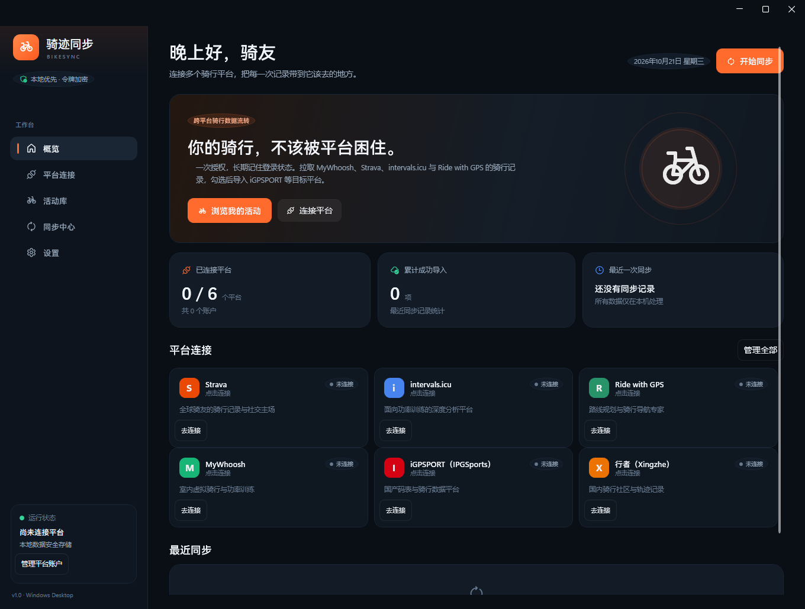
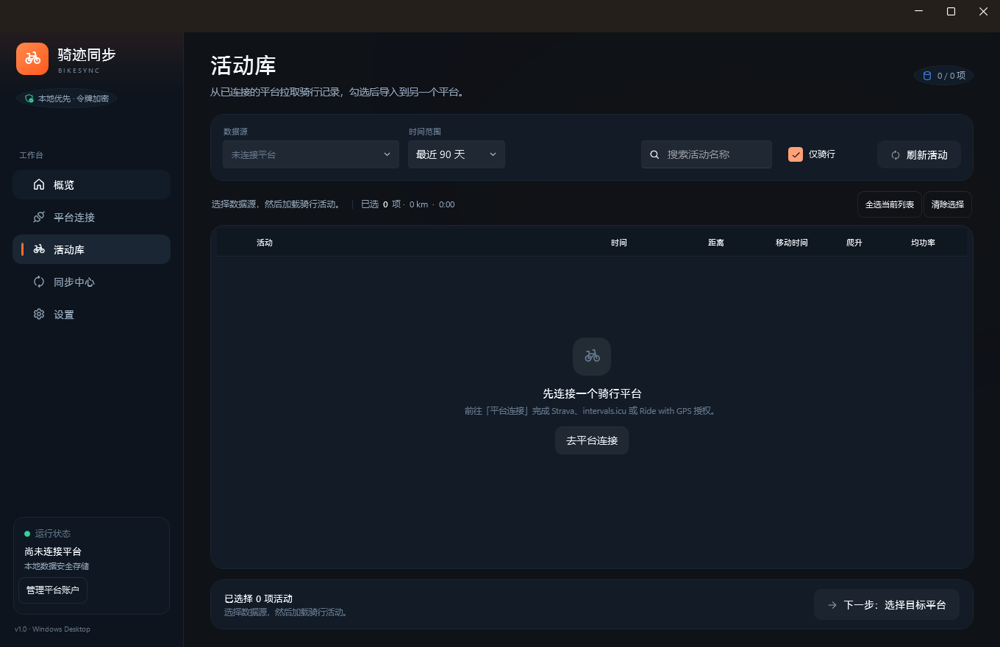
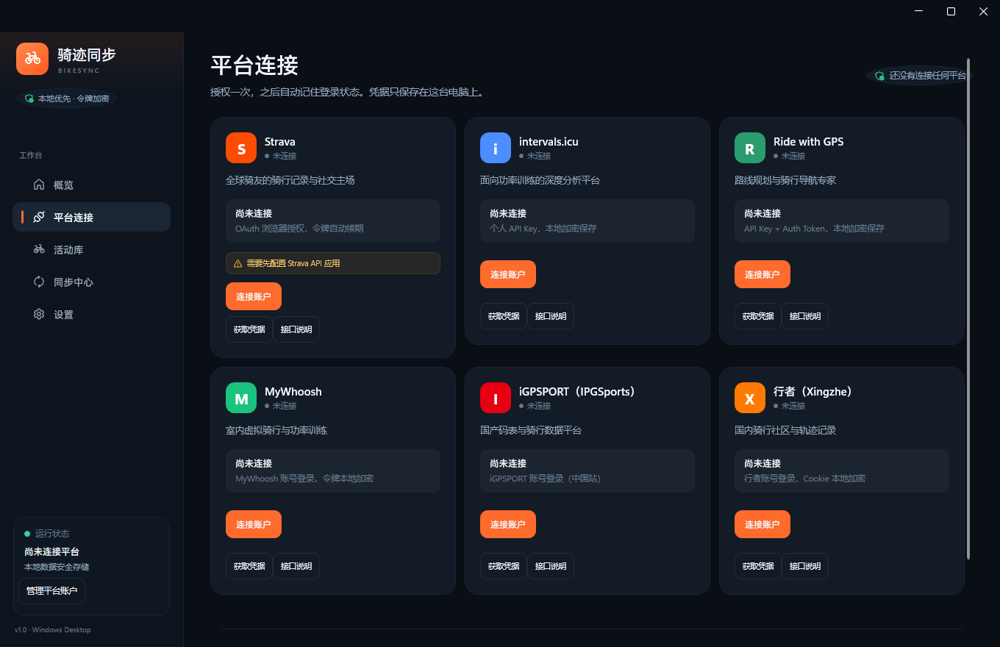
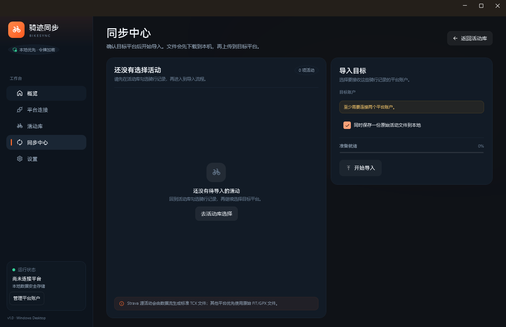

# 骑迹同步 · BikeSync

一个 Windows 桌面端骑行数据同步工具：**一次授权，长期记住登录状态**；从 MyWhoosh、Strava、intervals.icu、Ride with GPS、iGPSPORT、行者拉取骑行活动，勾选后可同时导入到 iGPSPORT、行者等多个目标平台。

使用 **WPF + WPF-UI 4.3** 构建，界面为 Fluent 深色主题。应用只在你选择的平台之间搬运活动文件，不依赖自建服务器。

- GitHub：[zsm19991230/BikeSync](https://github.com/zsm19991230/BikeSync)



## 功能

- **多平台持久登录**：Strava OAuth、intervals.icu 个人 API Key、Ride with GPS API Key + Auth Token、MyWhoosh / iGPSPORT / 行者账号登录。
- **本地加密保险箱**：所有访问令牌、刷新令牌和 API Key 使用 Windows DPAPI（`CurrentUser`）加密后保存在本机；账号密码只用于换取令牌，不会保存。
- **拉取骑行数据**：按最近 30 天 / 90 天 / 今年 / 自定义日期范围获取活动，支持搜索、仅骑行筛选和多选。
- **活动本地缓存**：每个账户最近一次成功拉取的活动会写入 `activity-cache.json`；启动应用和切换数据源时优先显示缓存，不再每次启动都请求平台。
- **多目标导入**：在同步中心勾选一个或多个目标平台，同一批活动会依次上传到每个目标，并分别显示每个目标的结果。
- **跨平台导入**：自动轮询平台异步处理结果，识别重复活动。
- **MyWhoosh → iGPSPORT 优化**：自动修正 MyWhoosh FIT 的 session 时间，按 FTP 补算 NP/IF/TSS，再上传到 iGPSPORT 中国站。
- **原始文件优先**：MyWhoosh 下载原始 FIT，intervals.icu 与 Ride with GPS 优先下载原始 FIT/GPX/TCX 文件。
- **Strava 源兼容**：Strava API 不提供原始活动文件下载，因此应用会使用 Strava 的 streams 数据生成标准 Garmin TCX 2.0 文件后上传。
- **本地副本**：可选择同时把下载到的活动文件保存到本地目录。
- **同步记录**：记录每次导入的成功、重复、失败数量，在概览页快速回看。
- **软件更新**：设置页检查 GitHub Releases，发现新版本后可下载更新包并自动替换、重启。
- **单实例运行**：避免两个进程同时写本地数据文件。

## 平台支持

| 平台 | 认证方式 | 拉取活动 | 下载文件 | 上传活动 | 备注 |
| --- | --- | --- | --- | --- | --- |
| Strava | OAuth 2.0 | 是 | streams → TCX | 是 | 需要自己的 Strava API 应用；官方 API 不提供原始文件 |
| intervals.icu | Personal API Key | 是 | 原始文件 / 生成 FIT | 是 | 个人使用无需开发者应用 |
| Ride with GPS | API Key + Auth Token | 是 | FIT / GPX / TCX | 是 | 使用 API clients 页面生成凭据 |
| MyWhoosh | 账号登录 | 是 | FIT | 否 | 仅作为数据源；登录可能接管其他设备的会话 |
| iGPSPORT（IPGSports） | 账号登录（中国站） | 是 | FIT | 是 | 可作为数据源或导入目标；上传时使用官方网页端的签名模块 |
| 行者（Xingzhe） | 账号登录 | 是 | GPX/流数据 → FIT | 是 | 可作为数据源或导入目标；上传设备标记为 iGPSPORT |

> 没有集成 Garmin Connect / Wahoo / Komoot：它们没有面向个人开发者的公开活动上传 API，或需要合作伙伴资质。平台适配层已经抽象为 `IPlatformProvider`，后续可以按同样接口扩展。

> iGPSPORT 与 MyWhoosh 使用的是其客户端/网页端接口，并非公开开发者 API；平台升级后可能需要同步更新适配器。

## 截图

| 概览 | 活动库 |
| --- | --- |
|  |  |

| 平台连接 | 同步中心 |
| --- | --- |
|  |  |

## 环境要求

- Windows 10 1809+ 或 Windows 11（WPF / DPAPI / ClearType）
- [.NET 8 SDK](https://dotnet.microsoft.com/download/dotnet/8.0)（从源码构建）
- 使用框架依赖发布时，目标机器需要 [.NET 8 Desktop Runtime](https://dotnet.microsoft.com/download/dotnet/8.0)

## 快速开始

```powershell
git clone <repository-url> bicycle-sync
cd bicycle-sync
dotnet restore BikeSync.sln
dotnet build BikeSync.sln -c Release
dotnet run --project BikeSync.App
```

发布为自包含目录（推荐，Wasmtime 原生库与 WPF 原生库会一起输出）：

```powershell
dotnet publish BikeSync.App/BikeSync.App.csproj `
  -c Release -r win-x64 --self-contained true `
  -p:PublishSingleFile=false `
  -p:DebugType=None -p:DebugSymbols=false `
  -o dist-app
```

生成的 `dist-app/BikeSync.exe` 可以直接在 64 位 Windows 上运行，不需要预装 .NET。

## 已生成的产物

- **便携版**：`release/BikeSync-win-x64.zip`（解压后运行 `BikeSync.exe`，自带 .NET 8 运行时）
- **源码包**：`release/BikeSync-source.zip`
- **已展开的便携版**：`dist-app/BikeSync.exe`

应用优先把数据写入 `%LocalAppData%\BikeSync`；若该位置不可写，会自动回退到程序目录旁的 `data`（便携模式），也可以在启动前设置 `BIKESYNC_DATA_DIR` 指定数据目录。

## 软件更新

当前版本：**v1.1.0**。

1. 打开「设置」→「软件更新」。
2. 点击「检查更新」，应用会读取 GitHub Releases 的最新版本。
3. 发现新版本后点击「下载并安装」：
   - 下载 `BikeSync-win-x64.zip` 到本地数据目录的 `updates` 文件夹；
   - 解压到临时 staging 目录；
   - 启动一个等待当前进程退出的更新脚本；
   - 用 staging 内容覆盖程序目录并重新启动。
4. 如果当前目录不可写或更新失败，可以点击「打开发布页」手动下载覆盖。

> 更新脚本只覆盖程序文件，不会删除 `%LocalAppData%\BikeSync` 中的账户、设置和活动缓存。

## 首次配置

### 1. Strava

1. 打开 [Strava API 设置](https://www.strava.com/settings/api)。
2. 创建一个 API Application。
3. 将 **Authorization Callback Domain** 填为 `127.0.0.1`。
4. 在应用「设置」中填写 **Client ID** 与 **Client Secret**。
5. 确认应用显示的回调地址为：
   ```
   http://127.0.0.1:53682/callback
   ```
6. 前往「平台连接」点击 Strava 的「连接账户」，在浏览器完成授权。

> 重点：Strava 的 `Activity: Read All` 与 `Activity: Write` 权限都需要授权。应用申请的 scope 为 `read,activity:read_all,activity:write`。如果平台页面没有勾选这些权限，读取私有活动或上传会失败。

### 2. intervals.icu

1. 登录 [intervals.icu 设置](https://intervals.icu/settings)。
2. 在页面底部找到 **API Key**。
3. 在应用「平台连接」中选择 intervals.icu，粘贴 API Key 并连接。

### 3. Ride with GPS

1. 登录 [Ride with GPS API clients](https://ridewithgps.com/api/api_clients)。
2. 创建一个 API client，记录 **API Key**。
3. 在该 client 页面创建一个 **Auth Token**。
4. 在应用「平台连接」中填写 API Key 与 Auth Token。

> Ride with GPS 的 Auth Token 目前没有刷新流程。如果平台侧撤销了 token，断开后重新生成并连接即可。

### 4. MyWhoosh

1. 在「平台连接」中选择 MyWhoosh，输入注册邮箱和密码。
2. 应用会调用 MyWhoosh 客户端登录接口，仅保存访问令牌和稳定的设备 ID。
3. 登录成功后即可在「活动库」选择 MyWhoosh 作为数据源。

> MyWhoosh 同一时间只允许一个客户端会话；如果账号已在手机上登录，应用可能会触发其他设备下线。密码不会保存。

### 5. iGPSPORT（IPGSports）

1. 在「平台连接」中选择 iGPSPORT，输入手机号/邮箱和密码。
2. 应用使用 iGPSPORT 中国站（`app.igpsport.cn`）的网页端签名流程登录，仅保存访问令牌。
3. 在「同步中心」选择 iGPSPORT 账户作为目标，即可导入 MyWhoosh 等活动。

> iGPSPORT 登录使用其公开网页端的签名模块；若平台更换签名算法，需要更新 `IGpsportSigner`。目前仅支持中国站账号。

### 6. 行者（Xingzhe）

1. 在「平台连接」中选择行者，输入行者账号和密码。
2. 应用通过行者网页登录页的公钥加密密码，仅保存登录 Cookie（DPAPI 加密）。
3. 在「活动库」选择行者作为数据源，可以拉取骑行记录；应用会把行者的 GPX 和采样流合成为 FIT。
4. 在「同步中心」勾选行者作为目标，即可导入 MyWhoosh / iGPSPORT 等 FIT 活动。

> 行者上传时使用 `device=3`（iGPSPORT）标记数据来源，`sport=3` 表示骑行。平台若调整接口，需要同步更新 `XingzheProvider`。

## 使用流程

1. **平台连接**：连接至少一个数据源平台和一个目标平台。
2. **活动库**：选择数据源与时间范围；启动时会先显示本地缓存，点击「刷新活动」才会请求平台。勾选一项或多项骑行记录。
3. **同步中心**：勾选一个或多个目标账户；确认是否保留本地副本，点击「开始导入」。
4. 等待每项活动显示每个目标的结果；详情中包含平台返回信息和本地文件路径。
5. 在「概览」查看最近同步记录。

### 数据流

```text
MyWhoosh ─────────► FIT（补正时间/NP/IF/TSS） ─┐
Strava streams ───► TCX 2.0 ────────────────────┤
intervals.icu ────► FIT/GPX ────────────────────┼──► iGPSPORT（可多选目标）
Ride with GPS ────► FIT/GPX ────────────────────┤
iGPSPORT ─────────► FIT ────────────────────────┤
行者 GPX/采样流 ──► 本地合成 FIT ──────────────┘
                                                   └──► 行者（FIT）
```

导入过程不会经过 BikeSync 的服务器。文件先下载到内存（可选写入本地），再直接上传到目标平台。

## 安全与隐私

- **DPAPI 加密**：`accounts.json` 中的 token 字段、`settings.json` 中的 Strava Client Secret 都是 DPAPI 密文。密文绑定当前 Windows 用户，换用户或换机器无法解密。
- **不写日志明文**：运行日志只记录错误栈、平台和活动 ID，不记录 token、API Key 或请求体。
- **本地文件位置**：
  - 账户：`%LocalAppData%\BikeSync\accounts.json`
  - 设置：`%LocalAppData%\BikeSync\settings.json`
  - 历史：`%LocalAppData%\BikeSync\sync-history.json`
  - 活动缓存：`%LocalAppData%\BikeSync\activity-cache.json`
  - 日志：`%LocalAppData%\BikeSync\logs\`
  - 活动导出：默认为 `%LocalAppData%\BikeSync\exports`，可在设置中修改。
- **便携回退**：如果当前目录策略禁止写入 `%LocalAppData%\BikeSync`，应用会自动改用可执行文件旁的 `data` 目录；也可以通过环境变量 `BIKESYNC_DATA_DIR` 指定数据目录。
- **断开连接**：只删除本机保存的令牌，不会删除平台上的活动。若需要彻底撤销授权，请同时在平台设置中移除对应应用。

## 项目结构

```text
BikeSync.sln
├─ BikeSync.App/                 WPF 桌面应用（WPF-UI / MVVM）
│  ├─ Views/                     Dashboard、Accounts、Activities、Sync、Settings
│  ├─ ViewModels/                CommunityToolkit.Mvvm
│  ├─ Services/                  DI、导航、通知、文件日志
│  └─ Themes/Styles.xaml         Fluent 深色主题与品牌样式
├─ BikeSync.Core/                与 UI 无关的核心库
│  ├─ Models/                    平台、活动、账户、同步模型
│  ├─ Abstractions/              存储与 Provider 接口
│  ├─ Services/                  DPAPI、JSON 存储、OAuth、TCX、同步编排
│  └─ Providers/                 Strava / intervals.icu / Ride with GPS / MyWhoosh / iGPSPORT / 行者
├─ BikeSync.Tests/               xUnit v3 测试（22 项）
└─ THIRD_PARTY_NOTICES.md        iGPSPORT 签名模块与第三方说明
```

## 测试

测试项目使用 xUnit v3 的进程内运行器，不依赖 VSTest：

```powershell
dotnet run --project BikeSync.Tests/BikeSync.Tests.csproj
```

覆盖内容包括：

- DPAPI 账户/设置加密与往返读取
- TCX 生成（轨迹点、心率、功率扩展）
- Strava 活动映射、streams 转换、上传轮询
- intervals.icu 列表、gzip 解压、上传
- Ride with GPS 列表、异步任务轮询
- 同步编排、本地副本保存、历史记录
- OAuth 回环接收器与 state 校验
- MyWhoosh OpenSSL 兼容加密信封
- iGPSPORT 官方网页端签名模块（固定测试向量）
- 活动缓存 JSON 的写入与读取
- 行者活动列表、采样数据合成 FIT 与 CRC 校验
- GitHub Release 更新检查与 Windows 资源选择
- FIT session 时间重写与 NP/IF/TSS 补算

## 已知限制

- **Strava 原始文件**：Strava 官方 API 不提供原始 FIT 下载。应用生成的 TCX 保留时间、GPS、海拔、心率、踏频和功率，但不保留原始设备文件中的圈段/设备字段。Strava 自身仍可能根据文件重新计算海拔。
- **Strava API 限流**：应用每次最多加载 200 项活动，受平台速率限制影响；如果平台返回限流错误，等待一段时间后重试。
- **Strava segments/laps**：生成文件是单圈 TCX，不导出 Strava 分段或分段成绩。
- **Ride with GPS 数据范围**：列表接口没有日期参数，应用会读取最近最多 10 页（1000 条）再在本地筛选日期。
- **MyWhoosh 限制**：只作为数据源，不提供公开上传接口；它返回的是原始 FIT，室内活动没有 GPS。补算 NP/IF/TSS 需要个人资料中有效的 FTP。
- **iGPSPORT 限制**：目前仅支持中国站账号；上传后通过活动标题中的临时标记确认导入结果，若平台处理超过约 30 秒，会提示“已提交、处理中”。iGPSPORT 侧暂不做跨平台自动去重。作为数据源时，下载接口依赖其网页端签名接口，平台调整后可能需要更新。
- **行者限制**：行者只提供 GPX 和采样流，应用会在本地合成 FIT；室内骑行可能没有 GPS 点，但仍会保留时间、功率、心率等采样。上传时固定使用 iGPSPORT 设备标记。行者网页接口变化时可能导致登录、拉取或上传失败。
- **缓存范围**：活动缓存保存的是最近一次成功拉取的结果，不会在后台自动更新；切换日期范围后如果缓存范围不足，界面会提示刷新。
- **无后台自动同步**：目前是手动拉取 + 手动导入，不做定时任务。
- **平台 API 变更**：平台接口可能调整；适配器集中在 `BikeSync.Core/Providers`，便于更新。
- **不撤销远端授权**：断开连接只清理本地 DPAPI 令牌。

## 开发说明

- WPF-UI 版本：`4.3.0`
- 目标框架：`net8.0-windows`
- MVVM：`CommunityToolkit.Mvvm 8.4.0`
- 平台适配：`IPlatformProvider`（`GetProfileAsync` / `ListActivitiesAsync` / `DownloadActivityAsync` / `UploadActivityAsync`）
- 所有平台调用都通过一个带 User-Agent、超时和自动解压的 `HttpClient`，便于统一处理 401/403/429。
- MyWhoosh / iGPSPORT 适配器使用客户端接口，不是官方开放平台；请遵守各平台服务条款，仅同步自己的数据。
- iGPSPORT 签名模块来自其公开网页资源（SHA-256 固定），通过 `Wasmtime` 在本机执行，不上传密钥。第三方说明见 `THIRD_PARTY_NOTICES.md`。

欢迎通过新增 `IPlatformProvider` 实现来扩展平台；UI 的「平台连接」页读取 `PlatformCatalog`，存储层无需修改。

## 字体与高 DPI

界面默认使用 `Segoe UI Variable Text / Microsoft YaHei UI`，并在窗口层启用 `Ideal` 文本排版、ClearType、布局取整和像素吸附。移除了 Mica 背景合成后，文字在 125% / 150% 缩放下会保持为 WPF 矢量文本，不再被 DWM 位图缩放。若你的显示器使用了自定义缩放，建议在 Windows「显示」设置中使用推荐缩放比例。

## License

MIT。iGPSPORT 签名模块及社区协议参考的第三方说明见 [THIRD_PARTY_NOTICES.md](THIRD_PARTY_NOTICES.md)。
